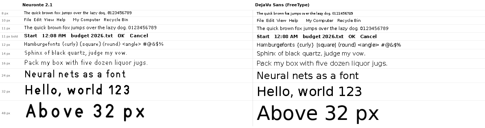

# Neuronte

Neuronte is a font made of small neural nets. You give it a character and
it writes that character's pixels into a buffer you own. There is no font
file, no glyph table and no bitmap atlas behind it. The weights are the
font.

This repository is **Neuronte 2**, the slim set: the C library and one
packed net for each job, and nothing else. It is 34 MB. The full project,
with the training code, every generation of every net and the measurements
behind them, is [Neuronte 0.1.x](https://github.com/itsmygithubacct/neuronte).
Every net is a file of [Neuronte 0.1.5](https://github.com/itsmygithubacct/neuronte/tree/v0.1.5),
copied byte for byte under the same name, and the library is 0.1.5's
source.
[CHANGES.md](CHANGES.md) lists what each version added.



Neuronte 2.1 on the left, DejaVu Sans through FreeType on the right,
enlarged two times. [Neuronte 2 and DejaVu Sans](docs/neuronte-and-dejavu.md)
explains the differences.

## Try it

It needs a C compiler and `make`, nothing else.

```sh
git clone https://github.com/itsmygithubacct/neuronte-v2
cd neuronte-v2
make demo
```

`make demo` builds the library and draws four lines in your terminal with
the desktop faces. Then draw your own:

```sh
./build/neuronte-say -s 14 "Hello from a neural net"
./build/neuronte-say -s 24 -b "Bold"          # -i for italic, 3 to 32 px
./build/neuronte-say -s 64 -o big.pgm "Big"   # also writes an image
```

Sizes from 1 to 16 use that size's own net, 17 to 32 one scalable net, and
larger sizes another. The source is [`demo/neuronte-say.c`](demo/neuronte-say.c), about a
hundred lines, and shows the whole of the text interface.

## What it draws

| Job | File | In depth |
|---|---|---|
| Terminal text: ASCII, accented Latin, Greek, Cyrillic, symbols, arrows, math signs, box and block characters, Braille | `neuronte-split-v9.nrt` | [split-v9](docs/neuronte-split-v9.md) |
| 1,864 more terminal characters, in four bundles opened beside the first: more Latin and Greek letters, arrows and math operators, technical and geometric signs, dingbats | `neuronte-term-latin-v1.nrt`, `neuronte-term-math-v1.nrt`, `neuronte-term-symbol-v1.nrt`, `neuronte-term-dingbat-v1.nrt` | [more characters](#more-terminal-characters) |
| Desktop text, 1 to 16 px, upright | `neuronte-ui1-v1.nrt` to `neuronte-ui16-v1.nrt` | [faces](#desktop-faces) |
| Desktop text, 3 to 16 px, italic | `neuronte-ui3-italic-v1.nrt` to `neuronte-ui16-italic-v1.nrt` | [faces](#desktop-faces) |
| Desktop text, 17 to 32 px, upright and italic | `neuronte-ui-scaled-latin1-v0.nrt`, with `neuronte-ui-scaled-latin1-italic-advances-v0.nrt` | [scaled face](docs/neuronte-ui-scaled-v0.md) |
| Desktop text above 32 px | `neuronte-ui-large-latin1-v1.nrt` | [large face](docs/neuronte-ui-large-v1.md) |
| 300 colour emoji | `neuronte-emoji-v1.nrt` | [emoji-v1][emoji] |
| 167 colour icons | `neuronte-icon-v2.nrt` | [icon-v2][icon] |
| The Kilix flame | `neuronte-flame-v1.nrt` | [flame-v1][flame] |
| A mouse pointer | `neuronte-pointer-v1.nrt` | [pointer-v1][pointer] |
| Video in a terminal | `neuronte-video-masks-v0.nrt` | [the video player](tools/neuronte-video.md) |

[FILES.md](FILES.md) lists every file with its size, its checksum and the
file of Neuronte 0.1.1 that did the same job.
[BENCHMARKS.md](BENCHMARKS.md) times a desktop drawn with this set, with
the faces of Neuronte 0.1.1, and with DejaVu Sans through FreeType. Once a
size's letters are kept, a string at 11 px takes 62 to 75 µs with Neuronte
2.1 against 193 to 261 µs with DejaVu, and Neuronte is ahead at every size
measured, up to 48 px.
[Neuronte 2 and DejaVu Sans](docs/neuronte-and-dejavu.md) explains how the
two differ: what each is, what reaches the screen, speed, size, coverage
and what each cannot do.

## Build it and check it

It needs a C compiler and `make`. The check also needs Python 3 with NumPy.

```sh
make          # build/libneuronte.so and build/libneuronte.a
make demo     # draws four lines of text in the terminal
make test     # checks every shipped file
```

`make test` does four things. It verifies every checksum. It checks the
packed text mask calls against a pixel loop. It draws every desktop face
from 1 to 16 px at its size, regular and bold, and compares each letter
with the face's drawing in `font/`: a face may have at most 2 wrong pixels,
none on a digit, and every advance must be exact. Today every face has 0.
And it compares every net's pixels, over a fixed list of characters, and
lines of text drawn by the two scalable faces, with the values recorded in
`tests/golden.json` when this set was cut.

## Use it

The whole interface is [`include/neuronte.h`](include/neuronte.h), and every
file opens with the same call.

Terminal text is drawn a cell at a time:

```c
#include "neuronte.h"

neuronte *font;
if (neuronte_open_file("weights/neuronte-split-v9.nrt", &font) != NEURONTE_OK)
    return 1;
/* pixels: row-major 0xAARRGGBB, stride in pixels. A 16 x 32 cell at x, y. */
neuronte_draw_utf8(font, pixels, stride, width, height,
                   x, y, 16, 32, "Hello", 5, 0xFFFFFFFF);
neuronte_close(font);
```

Desktop text is drawn a line at a time, with each letter's own width. Open
the face for the size you want and draw at that size (from 17 px the file
is `neuronte-ui-scaled-latin1-v0.nrt` for every size to 32, and above that
`neuronte-ui-large-latin1-v1.nrt`):

```c
neuronte *face;
neuronte_open_file("weights/neuronte-ui14-v1.nrt", &face);
neuronte_set_binary(face, 1);            /* crisp pixels, as the face was drawn */
int w = neuronte_text_width(face, "Hello", 5, 0 /* bold */, 14);
neuronte_draw_text(face, pixels, stride, width, height,
                   x, y, 14, 0 /* bold */, "Hello", 5, 0xFFFFFFFF);
neuronte_close(face);
```

A program that draws the same small text over and over, as a desktop does,
can keep each letter's pixels after the net has drawn it once and lay lines
out of the kept letters with `neuronte_bits_pack()` and
`neuronte_bits_compose()`; no net runs then. [BENCHMARKS.md](BENCHMARKS.md)
has the effect.

A handle keeps the cells it has drawn, so drawing the same character again
is a copy. Do not share one handle between threads without a lock. The
[Use section of the 0.1.x README][use] covers colour files, palettes and
themes, coverage without drawing, and loading weights from memory.

## How it works, briefly

Each net is a small multilayer perceptron. It is asked about one point in
a character's cell at a time and answers how far that point is from the
ink. The library asks it about every pixel and turns the answers into
coverage. Because the net answers for a point and not a pixel, the same
weights draw a cell of any size.

One large net for everything is slow, so the files here are **bundles** of
many small nets. A table sends each character to the one small net that was
trained on it, and only that net runs. That is why this set is several
times faster than Neuronte 0.1.1 at the same pixels. More:

- [The net][net]: its inputs, layers and output.
- [Split nets and the router][router]: how a bundle picks a net.
- [Character groups and tiles][decomposition]: how a job is cut into small nets.
- [Speed][speed] and [quality][quality]: how each is measured.
- [Changes in 0.1.2][changes]: what got faster, and by how much.

## Desktop faces

Each size from 1 to 16 px has its own net, because each small size is its
own hand-placed pixel design and not one shape scaled. A net reproduces its
size exactly; no net draws another size's design.

From 17 to 32 px one file, `neuronte-ui-scaled-latin1-v0`, draws every size from
one design, the strokes the hand faces were first fitted to. The library
snaps its straight stems to whole pixels, so a stem is exactly 2 px wide
from 17 to 26 px, and it draws black and white like the small faces. It is
a different face from the hand-drawn ones it replaced, not a copy: against
them about a third of the letter widths differ, by at most 2 px, and the
shapes differ by some tens of pixels a letter. In exchange one 2.5 MB file
does the work of 32 files of 17.4 MB, and it adds the 58 accented letters
of Latin-1 (U+00C0 to U+00FF: `é`, `ñ`, `ü`, `ß` and the rest), each a
letter of the face with a mark placed over it. The sizes from 1 to 16 px
have no accented letters. Italic is the same letters sheared as
they are drawn (`NEURONTE_STYLE_ITALIC`), stepped by the advances in
`neuronte-ui-scaled-latin1-italic-advances-v0`; `demo/neuronte-say.c` shows how.
[Its card](docs/neuronte-ui-scaled-v0.md) has the measurements for every
size. Scaled below 17 px the design is not good enough to ship, and below
10 px it is not legible, which is why the small sizes stay hand-drawn.

Above 32 px one file, `neuronte-ui-large-latin1-v1`, draws any size with smooth
edges. It is the face of `neuronte-ui-large-v0` cut into four smaller nets,
about 13 times as fast the first time a size is used, with the same
Latin-1 letters added by two more nets. It did not
meet the accuracy limit set for it before it was trained (it is behind the
old net at 32 px, a size it is not used for, and on its worst letter at 48
and 96 px) and ships by the owner's decision;
[its card](docs/neuronte-ui-large-v1.md) gives the numbers.

The hand-drawn faces were made in groups, each with a card that gives the
recipe, the acceptance rule and the measured speed of every face in it:

| Faces | Card |
|---|---|
| 1 to 15 px; italics 3 to 12, 14 and 15 px | [small faces][faces-small] |
| 16 px; italics 13 and 16 px | [narrower single nets][faces-192-256] |

A desktop also needs to know where a face sits in its cell and how wide
each letter is. `font/ui-tops.json` gives the first, and each
`font/ui-EM.txt` holds that size's advances and pixels.

## More terminal characters

Four more bundles draw 1,864 characters the terminal bundle was not trained
on. With it that is 3,205 characters. Each is a file of its own, opened
beside `neuronte-split-v9.nrt`; none of them draws ASCII or anything else
split-v9 draws, and no two share a character.

| File | Characters | Nets and the limits set before training |
|---|---|---|
| `neuronte-term-latin-v1.nrt` | 596 more Latin letters: Latin Extended-B, IPA, spacing modifiers, Latin Extended Additional, Greek Extended | 74 nets; 3 passed the limits set before training, 71 missed them and ship by the owner's choice; [card](https://github.com/itsmygithubacct/neuronte/blob/v0.1.5/weights/neuronte-term-latin-v1.md) |
| `neuronte-term-math-v1.nrt` | 465 arrows and mathematical operators | 47 nets; 24 passed, 23 missed and ship by the owner's choice; [card](https://github.com/itsmygithubacct/neuronte/blob/v0.1.5/weights/neuronte-term-math-v1.md) |
| `neuronte-term-symbol-v1.nrt` | 480 punctuation, letterlike, technical and geometric characters, and U+FFFD | 48 nets; 20 passed, 28 missed and ship by the owner's choice; [card](https://github.com/itsmygithubacct/neuronte/blob/v0.1.5/weights/neuronte-term-symbol-v1.md) |
| `neuronte-term-dingbat-v1.nrt` | 323 Miscellaneous Symbols and Dingbats | 35 nets; 11 passed, 24 missed and ship by the owner's choice; [card](https://github.com/itsmygithubacct/neuronte/blob/v0.1.5/weights/neuronte-term-dingbat-v1.md) |

A program opens the five files and, for each character, draws with the
first whose `neuronte_untrained(handle, character)` is 0:

```c
static neuronte *pick(neuronte **bundle, int count, uint32_t character) {
    for (int i = 0; i < count; i++)
        if (neuronte_untrained(bundle[i], character) == 0)
            return bundle[i];
    return bundle[0]; /* nobody was trained on it: split-v9, with its mark if asked */
}
```

`weights/NAME.list.txt` beside each bundle lists the characters it was
trained on, as `U+XXXX` and `U+XXXX..U+YYYY`, for a program that would
rather build one table. `make test` checks every bundle against its list.
An invalid code (a surrogate, or a value above U+10FFFF) is drawn as
U+FFFD by the library, so `neuronte-term-symbol-v1`, which has U+FFFD,
reports those trained too.

Most of these nets missed at least one of the limits set for them before
they were trained: 58 of the 204 passed with both seeds, and the other 146
ship because the owner looked at them side by side with the drawings and
chose to. Each card says which limit each net missed and by how much. The
drawings are the project's own; no font file was read to make them.

## The nets, one by one

- **Terminal bundle.** `neuronte-split-v9` is [split-v8][split-v8] with 165
  more characters on fourteen small nets: check and cross marks, arrows,
  bullets and shapes, `± ≤ ≥ ≠`, currency, superscripts and fractions, math
  operators, Greek with tonos and the Cyrillic letters beyond Russian.
  Every character split-v8 drew, it draws the same. All fourteen new nets
  missed the limits set for them before they were trained and ship by the
  owner's choice after a side-by-side review;
  [the card](docs/neuronte-split-v9.md) says where each missed. A character
  the bundle was not trained on is still drawn, by a net that never saw
  it, as some other shape: `neuronte_untrained()` tells a program which
  characters those are, and `neuronte_set_untrained()` draws a plain mark
  in their place. split-v8 is built from parts, each with
  its own card: [ASCII in four groups][ascii], [Braille as tiles][braille],
  [symbols][symbol], [block, sextant and octant characters][pixel], and
  [accented Latin, Greek and Russian][accent]. Two of those parts, the pixel
  and accent groups, missed the strict limits set before they were trained
  and were chosen after a side-by-side review; the split-v8 card lists what
  differs.
- **Emoji.** [emoji-v1][emoji]: twelve nets over a partition balanced by
  difficulty, about five times as fast as the one it replaces.
- **Icons.** [icon-v2][icon]: four nets of three layers. It is about four
  times as fast as icon-v1 and a little less exact at 12 px.
- **Flame and pointer.** [flame-v1][flame] and [pointer-v1][pointer] are
  narrower nets of the same drawings.
- **Video.** [The player](tools/neuronte-video.md) plays a video in a
  terminal. Its default mode needs only `neuronte-video-masks-v0.nrt`.

## What is not here

- The older files: `neuronte-split-v5`, the `-v0` desktop faces and the
  rest. A program that used them names the files above instead.
- The hand-drawn faces from 17 to 43 px. `neuronte-ui-scaled-latin1-v0` and
  `neuronte-ui-large-latin1-v1` cover those sizes; the hand-drawn ones are in
  Neuronte 0.1.x and in Neuronte 2.1.0.
- The learned video helpers. They are tied to `neuronte-split-v5`, so the
  player here has no `--helper` option, and its cells mode draws with
  `neuronte-split-v9`.
- Training code, weights as JSON, second seeds, scores and research
  records. They are in [Neuronte 0.1.x][repo], where every net can be
  retrained and rechecked. `train/glyphs.py` and `train/strokes.py` are here
  only because the video player and the check import them.

## Where things came from

[PROVENANCE.md](PROVENANCE.md) says how the drawings and nets were made.
The licence is MIT; see [LICENSE](LICENSE). The optional media library,
built with `make media`, links FFmpeg; see
[THIRD_PARTY_NOTICES.md](THIRD_PARTY_NOTICES.md).

[repo]: https://github.com/itsmygithubacct/neuronte
[readme]: https://github.com/itsmygithubacct/neuronte/blob/v0.1.2/README.md
[use]: https://github.com/itsmygithubacct/neuronte/blob/v0.1.2/README.md#use
[net]: https://github.com/itsmygithubacct/neuronte/blob/v0.1.2/README.md#the-net
[router]: https://github.com/itsmygithubacct/neuronte/blob/v0.1.2/README.md#split-nets-and-the-router
[speed]: https://github.com/itsmygithubacct/neuronte/blob/v0.1.2/README.md#speed
[quality]: https://github.com/itsmygithubacct/neuronte/blob/v0.1.2/README.md#quality
[changes]: https://github.com/itsmygithubacct/neuronte/blob/v0.1.2/CHANGES.md
[decomposition]: https://github.com/itsmygithubacct/neuronte/blob/v0.1.2/train/DECOMPOSITION.md
[split-v8]: https://github.com/itsmygithubacct/neuronte/blob/v0.1.4/weights/neuronte-split-v8.md
[ascii]: https://github.com/itsmygithubacct/neuronte/blob/v0.1.2/weights/neuronte-ascii-next.md
[braille]: https://github.com/itsmygithubacct/neuronte/blob/v0.1.2/weights/neuronte-braille-v1.md
[symbol]: https://github.com/itsmygithubacct/neuronte/blob/v0.1.2/weights/neuronte-symbol-v1.md
[pixel]: https://github.com/itsmygithubacct/neuronte/blob/v0.1.2/weights/neuronte-pixel-groups-v1.md
[accent]: https://github.com/itsmygithubacct/neuronte/blob/v0.1.2/weights/neuronte-accent-groups-v1.md
[emoji]: https://github.com/itsmygithubacct/neuronte/blob/v0.1.2/weights/neuronte-emoji-v1.md
[icon]: https://github.com/itsmygithubacct/neuronte/blob/v0.1.2/weights/neuronte-icon-v2.md
[flame]: https://github.com/itsmygithubacct/neuronte/blob/v0.1.2/weights/neuronte-flame-v1.md
[pointer]: https://github.com/itsmygithubacct/neuronte/blob/v0.1.2/weights/neuronte-pointer-v1.md
[faces-small]: https://github.com/itsmygithubacct/neuronte/blob/v0.1.2/weights/neuronte-ui-v1-small.md
[faces-192-256]: https://github.com/itsmygithubacct/neuronte/blob/v0.1.2/weights/neuronte-ui-v1-192-256.md
