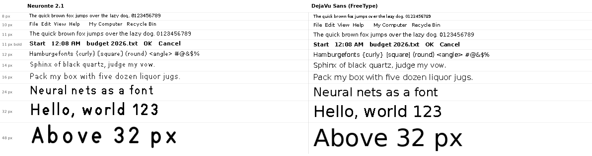

# Neuronte 2 and DejaVu Sans

DejaVu Sans is the font an ordinary Debian desktop falls back to, drawn by
the FreeType library. Neuronte 2 draws the same kind of text with small
neural nets. This article sets the two side by side: what each one is,
what each puts on the screen, what each costs, and what each cannot do.

The measurements are of DejaVu Sans 2.37 as Debian 13 ships it, drawn by
FreeType through Pillow 11.1.0, and of Neuronte 2.1.0, both inside the
[Kilix 95](https://github.com/itsmygithubacct/kilix-95) desktop, which can
use either. Where a number comes from a run, the script is in
[`bench/`](../bench/).

Neuronte 2.1.1 changed the sizes from 17 px up: one scalable net now draws
17 to 32 px in place of a hand-drawn net for each size, and the net above
32 px was replaced by a faster one. Everything here about sizes 1 to 16 px
holds for 2.1.1. The rows for 24, 32 and 48 px, the picture's lower lines
and the byte counts describe 2.1.0; [CHANGES.md](../CHANGES.md) has the
new figures (32.0 MB of weights in all), and from 17 px up the faces now
also draw the accented letters of Latin-1.

## In one table

| | DejaVu Sans with FreeType | Neuronte 2 desktop faces |
|---|---|---|
| What the font is | Outlines: curves that describe each letter's edge | Weights: nets trained on pixel drawings of each letter |
| What draws it | FreeType scales the outline, hints it and fills it | The Neuronte library runs a net once for each letter, then copies the result |
| Sizes | Any size, whole or fractional | One net for each whole size from 1 to 32 px; one scalable net above 32 px |
| Edges at desktop sizes | Grey (antialiased) by default; black and white on request | Black and white only, up to 32 px; grey above |
| Letter widths | Fractions of a pixel | Whole pixels |
| Kerning | 2,727 pairs in the regular face | None |
| Characters | 5,918 code points in the regular face | 96 in a desktop face; the terminal bundle has more (below) |
| Bold | A separate bold design | The regular letter struck twice, one pixel apart |
| Italic | A separate slanted outline (Oblique) | The regular drawing sheared on its own grid, 3 to 32 px |
| On disk | 0.76 MB regular, 2.1 MB with bold and oblique | 36 MB for the 62 size files, 1.3 MB for the scalable one |
| Same pixels everywhere | Depends on the FreeType version and its hinting settings | The pixels are fixed by the weight file and checked by `make test` |
| Licence | DejaVu Fonts licence (Bitstream Vera and Arev terms, with public-domain changes) | MIT |

## What each one is

A DejaVu file is a TrueType font. For each of its 6,253 glyphs it holds
an outline made of straight lines and quadratic curves on a 2,048-unit
grid, a width, and a small program of hinting instructions. Tables around
the glyphs map code points to them (`cmap`), adjust pairs of letters
(`kern`, `GPOS`) and substitute one glyph for another (`GSUB`). To draw a
letter at 11 px, FreeType scales the outline to 11 px, runs the hinting
program to pull stems onto pixel boundaries, and fills the result,
reporting for each pixel how much of it the outline covers.

A Neuronte desktop face has no outline. Each size was drawn by hand as
pixels: [`font/ui-11.txt`](../font/ui-11.txt) is the 11 px design, a grid
of `#` and `.` for each letter, with its width. A small multilayer
perceptron is then trained to reproduce that drawing: asked about a point
in a letter's cell, it answers how far the point is from the ink.
`neuronte-ui11-v1.nrt` is that net's weights and the table of widths. The
library asks the net about every pixel of a letter and turns the answers
into pixels. `make test` draws every letter of every size, regular and
bold, and compares it with the drawing; today all 11,904 match with no
pixel wrong.

So the two keep different things. DejaVu keeps one shape and computes
every size from it. Neuronte keeps a separate decision, made by a person,
about which pixels each size should light, and a net that has learned
those decisions. [PROVENANCE.md](../PROVENANCE.md) records that no font
file was read to make the drawings.

## What reaches the screen



The same ten lines drawn by each, enlarged two times so that single pixels
show. Both are drawn as Kilix 95 draws them: black and white up to 32 px,
antialiased at 48 px. From 8 to 12 px the two are close in size and
weight. From 14 px up Neuronte keeps a thin stroke and open spacing, while
DejaVu's stroke thickens with the size. `bench/render_dejavu_demo.py`
drew each half.

The same word at 11 px, black and white, as Kilix 95 draws it. Neuronte
2.1 first, then DejaVu Sans:

```
.........................#................................##.......................................................
#....#...................#...............................#.................#..............###.....#.....###....###.
#....#...................#...............................#.................#.............#...#...##....#...#..#...#
#....#...###...####.##...####...#...#..#.#..####...###...###..###...####...###..####.....#...#....#........#......#
######......#..#...#..#..#...#..#...#..##..#...#..#...#..#...#...#..#...#..#...#.........#...#....#.......#....###.
#....#...####..#...#..#..#...#..#...#..#...#...#..#####..#...#...#..#...#..#....##.......#...#....#......#........#
#....#..#...#..#...#..#..#...#..#...#..#...#...#..#......#...#...#..#...#..#......#......#...#....#.....#.....#...#
#....#..#...#..#...#..#..#...#..#...#..#...#...#..#......#...#...#..#...#..#.......#.....#...#....#....#......#...#
#....#...####..#...#..#..####....####..#....####...####..#....###...#...#...##.####.......###....###...#####...###.
...............................................#...................................................................
............................................###....................................................................
```

```
..........................#................................##......................................................
#....#....................#...............................#................#..............###...###.....###....###.
#....#....................#...............................#................#.............##.##....#....#...#..#...#
#....#...###...####.###...####...#...#..#.##.####...###..####..###..####..####...###.....#...#....#........#......#
######......#..#...#...#..#...#..#...#..##..#...#..#...#..#...#...#.#...#..#....#...#....#...#....#........#...###.
#....#...####..#...#...#..#...#..#...#..#...#...#..#####..#...#...#.#...#..#....###......#...#....#.......#.......#
#....#..#...#..#...#...#..#...#..#...#..#...#...#..#......#...#...#.#...#..#.......##....#...#....#......#........#
#....#..#...#..#...#...#..#...#..#...#..#...#...#..##..#..#...#...#.#...#..#....#...#....##.##....#.....#.....#...#
#....#...####..#...#...#..####....####..#....####...###...#....###..#...#..###...###......###...#####..#####...###.
................................................#..................................................................
.............................................###...................................................................
```

Both are plain sans-serif letters of the same height, and at this size
each stem is one pixel wide in both. The differences are in the spacing
and in single letters: `m`, `e`, `s`, `t`, `0`, `1` and `2` are visibly
different shapes. Neuronte's letters sit on whole-pixel positions, while
FreeType places each DejaVu letter at a fractional position and rounds.

One line of 55 characters ("The quick brown fox jumps over the lazy dog.
0123456789"), measured at seven sizes:

| Size | Line width, Neuronte | Line width, DejaVu | Bold adds, Neuronte | Bold adds, DejaVu | `i` / `W` width, Neuronte | `i` / `W` width, DejaVu | Grey pixels, Neuronte | Grey pixels, DejaVu |
|---:|---:|---:|---:|---:|---:|---:|---:|---:|
| 8 px | 265 | 236.06 | 55 | 28.25 | 3 / 8 | 2.22 / 7.91 | 0 | 816 |
| 11 px | 326 | 324.48 | 55 | 38.78 | 3 / 9 | 3.06 / 10.88 | 0 | 1142 |
| 14 px | 385 | 412.84 | 55 | 49.50 | 4 / 12 | 3.89 / 13.84 | 0 | 1794 |
| 16 px | 437 | 472.12 | 55 | 56.56 | 4 / 14 | 4.45 / 15.83 | 0 | 2119 |
| 24 px | 674 | 707.75 | 55 | 85.11 | 7 / 22 | 6.67 / 23.73 | 0 | 3127 |
| 32 px | 959 | 943.67 | 55 | 113.19 | 10 / 30 | 8.89 / 31.64 | 0 | 4259 |
| 48 px | 1438 | 1415.80 | 110 | 169.75 | 15 / 45 | 13.34 / 47.47 | 5279 | 6471 |

Widths are in pixels. "Grey pixels" counts the pixels that are neither
empty nor full when the line is drawn with antialiasing asked for.

What the table shows:

- **Whole pixels against fractions.** Every Neuronte width is a whole
  number. A string's width is the sum of its letters' widths, so a
  program can lay out text by adding integers and the result is exact.
  DejaVu's widths are fractions, and where a letter lands depends on what
  came before it.
- **No grey up to 32 px.** A Neuronte face from 1 to 32 px lights a pixel
  fully or not at all, whatever is asked for. DejaVu drawn with
  antialiasing is mostly grey at small sizes: at 11 px the line has 1,142
  partly covered pixels and 147 full ones. Above 32 px Neuronte's scalable
  net also gives grey edges.
- **Bold is a second strike.** Neuronte bold is the regular letter drawn
  again one pixel to the right, so each letter grows by exactly one pixel
  (two at 48 px) and the 55-character line by 55. DejaVu Bold is a
  different, heavier design and grows the line by 12 percent.
- **No kerning.** DejaVu moves `V` 0.70 px closer to `A` at 11 px.
  Neuronte puts each letter where the last one's width ends.
- **A different measure of size.** At the same nominal size the lines are
  close in width (326 against 324.5 px at 11 px), but Neuronte's sizes are
  not DejaVu scaled: the 8 px face is wider than DejaVu at 8 px and the
  14 to 24 px faces are narrower, and the 32 px face is wider again. Each
  size is its own design.

## Speed

From [BENCHMARKS.md](../BENCHMARKS.md), on an Intel Core i7-6820HQ, three
cold and three warm runs of each:

| | DejaVu | Neuronte 2.1 |
|---|---:|---:|
| Desktop's first frame, cold start | 0.440 s | 0.434 s |
| One string at 11 px, letters already kept | 261 µs | 75 µs |
| One string at 32 px, letters already kept | 416 µs | 252 µs |
| One string at 48 px, letters already kept | 565 µs | 480 µs |
| Measuring a string's width at 11 px | 22 µs | 5.5 µs |
| First use of a size's letters, 12 px | (none) | 13 ms |
| First use of a size's letters, 32 px | (none) | 220 ms |
| First use of the scalable face, 48 px | (none) | 3.7 s |

A net is slower than an outline when it actually runs: drawing the 96
letters of the 32 px face for the first time takes about a fifth of a
second. But a desktop draws the same few dozen letters over and over, so
Kilix 95 keeps each letter's pixels after the net has drawn it, saves them
to disk, and afterwards lays a line out of kept letters
with one call into the library (`neuronte_bits_compose()`). No net runs
then, and a string takes less time than FreeType takes for DejaVu at
every size measured. Measuring is faster still because it is a sum of
whole numbers.

The scalable face above 32 px is the exception. Its first use at a new
size costs seconds, and it is the same file in Neuronte 0.1.1, 0.1.2 and
2.

## Size on disk

DejaVu Sans is 759,720 bytes; with Bold and Oblique it is 2.1 MB, and
that covers every size. Neuronte's desktop faces are 62 files, one for
each size and slant, and 36,123,084 bytes together; the 11 px face alone
is 864,092 bytes. The scalable net is another 1,325,072 bytes. Neuronte
spends about 18 times the bytes to draw 96 characters where DejaVu draws
5,918.

## What each covers

A Neuronte desktop face has 96 characters: printable ASCII and the
ellipsis. When a string holds any other character, Kilix 95 measures and
draws the whole string with DejaVu, so the two are never mixed on one
line. Text in another script, accented names and most symbols are
therefore still DejaVu on a Neuronte desktop.

The terminal bundle, `neuronte-split-v9.nrt`, is a different kind of
face: one design drawn into a cell of any size, covering ASCII, accented
Latin, Greek, Russian, symbols, box and block characters and Braille. It
is what a terminal uses, and it is not compared here.

DejaVu Sans maps 5,918 code points: Latin with its extensions, Greek,
Cyrillic, Armenian, Hebrew, Arabic, mathematical operators, arrows and
many symbols. With a shaping library it joins Arabic letters, places
combining marks and applies its substitution tables. Neuronte does none
of that: it draws left to right, one code point to one letter.

## What stays the same from machine to machine

What FreeType draws for DejaVu depends on the FreeType version, on
whether the font's own hinting or the automatic hinter is used, and on
antialiasing and subpixel settings. Two machines can show the same text
with different pixels, and widths can differ with them.

A Neuronte face from 1 to 32 px has one answer for each letter, fixed by
the weight file. `make test` checks every letter of every size against
its drawing on the machine it runs on, and compares every net's output
with values recorded when this set was cut. The checks so far have run on
x86-64.

## Changing a letter

To change a letter in DejaVu, edit its outline; every size follows. To
change a letter in Neuronte, edit the pixel drawing for each size that
should change and train that size's net again, which the full project,
[Neuronte 0.1.x](https://github.com/itsmygithubacct/neuronte), has the
code for. That is more work for each change, and it is the point of the
design: each size is exactly what was drawn, not what a scaler and a
hinter made of a shape.

## Which to use

- Use Neuronte for interface text in ASCII at 1 to 32 px, where exact,
  repeatable, black-and-white pixels and whole-pixel layout matter, and
  where the same letters are drawn many times.
- Use DejaVu, or any outline font, for other scripts, for text that needs
  kerning or shaping, for arbitrary or fractional sizes, for rotated or
  transformed text, for antialiased small text, and where 37 MB of weights
  is too much.
- A desktop can use both, as Kilix 95 does: Neuronte where a face covers
  the string, DejaVu elsewhere.
