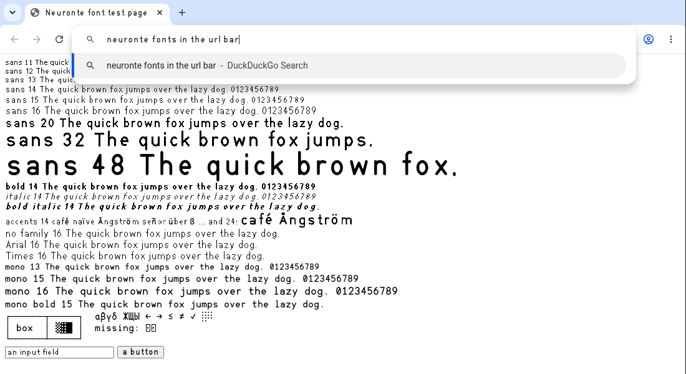
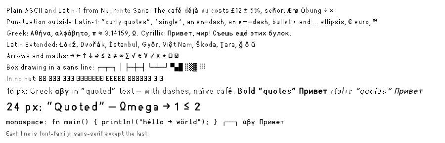

# Font files made from the nets (`neuronte-fontfile`, `neuronte-setup`)

A program that draws its text through fontconfig and FreeType (a browser, a
GTK or Qt program) cannot run a net. On a machine with no font installed
such a program has nothing to draw with, and some do not start at all:
Chromium 156 stops with "Could not find any font" when fontconfig has no
font to give it.

`neuronte-fontfile` runs the nets once and writes what they drew as
TrueType files that those programs load like any font. `neuronte-setup`
makes the files when Neuronte is installed and again at start whenever
they are absent or the weights changed. Nothing in the files comes from
another font: every outline and every pixel is a net's answer, every
advance is from a net's table, and the tables are written from the
OpenType specification.



Chromium 156 on a machine whose fontconfig knows only these files. The
page lines of 11 to 32 px are the nets' own pixels. The one line in another
face is Chromium's list of suggestions under the URL bar: see
[What a program still does itself](#what-a-program-still-does-itself).

## The files

| File | Family, style | Characters | Outline from | Bitmap strikes |
|---|---|---:|---|---|
| `NeuronteSans-Regular.ttf` | Neuronte Sans, Regular | 154 | `neuronte-ui-large-latin1-v1` | 1 to 32 px, 1 bit |
| `NeuronteSans-Bold.ttf` | Neuronte Sans, Bold | 154 | the same, the library's bold | 1 to 32 px, 1 bit |
| `NeuronteSans-Italic.ttf` | Neuronte Sans, Italic | 154 | the same, the library's shear | 3 to 32 px, 1 bit |
| `NeuronteSans-BoldItalic.ttf` | Neuronte Sans, Bold Italic | 154 | both | 3 to 32 px, 1 bit |
| `NeuronteMono-Regular.ttf` | Neuronte Mono, Regular | 4,958 | the terminal bundles | 9, 12, 13, 15, 16, 17, 20 px, 8 bit, ASCII and Latin-1 |

2,337,012 bytes together with the weights of 2.4.0 (154,968, 159,784,
163,276, 168,656 and 1,690,328). The 4,958 of Neuronte Mono are the
4,919 terminal characters of `neuronte-split-v9` and the ten
`neuronte-term-*` bundles and the 39 symbols of
`neuronte-kilix-chrome-v1`; with the weights of 2.3.0 it was 3,205
characters in 1,125,900 bytes.

**Characters.** A file maps exactly the characters its nets were trained
on (`neuronte_untrained()` is 0) and nothing else. Neuronte Sans has the
154 of the scalable desktop face: printable ASCII, the ellipsis, the
no-break space, and 57 accented letters and spacing accents of Latin-1.
It does not have the other 38 Latin-1 characters, among them `£ ± × ÷ ß
Æ ø § © « »`. Neuronte Mono has every character of the newest
`neuronte-split-vN.nrt`, of every `neuronte-term-*.nrt` and of every
`neuronte-kilix-*.nrt` in the weights directory, in that order and by
name within each, a character going to the first bundle trained on it:
text before a terminal's own symbols. The list of bundles is read from
the directory each time, so a bundle added later is in the next file.
Glyph 0, shown for a character the file does not have, is the library's
own mark for an untrained character.

A glyph of Neuronte Mono is one cell, so a bundle whose drawings are
made for another box is left out: one with a card `NAME.symbols.txt`
beside it in the weights directory, which is how
`neuronte-kilix-chrome-v2` (drawn for a box of two cells) and
`neuronte-weather-colour-v1` (colour, in two halves) say what they
are; a bundle of one-cell characters has `NAME.list.txt` or no card.
Install the cards with the weights. With the weights of 2.4.0 the
glyphs are the same without them (the file then differs only in its
record of the weight files it was made from), because every symbol of
`neuronte-kilix-chrome-v2` is drawn for one cell by a bundle before it,
and the weather bundle is not a term or kilix bundle by name. The 39
symbols of `neuronte-kilix-chrome-v1` are in the file: most are
private-use code points of the symbol fonts that terminals print, drawn
for one cell.

**Outlines.** Each character's net is asked for its coverage of a cell
64 px wide (`neuronte_coverage()`, one sample a pixel), and the line where
the coverage is one half is traced by marching squares, placed between
pixel centres by the two coverages, and thinned (Douglas-Peucker, 0.1 px).
The result is polygons: every point is on the curve, there are no control
points and no hinting instructions. The `H` of Neuronte Sans has 47
points where a drawn `H` has 12, because the net's edge is not perfectly
straight.
`make test` fills each outline again at 64 px and compares it with the
net: the mean difference is 2 pixels of a cell's 8,192 for Sans and 5 for
Mono, the worst 47, the limit 65.

**Strikes.** Below 33 px the desktop faces are black and white pictures
that a net was trained to draw at one size each (1 to 16 px) or snaps to
whole pixels (17 to 32 px). An outline scaled down does not give those
pictures, so the Sans files also carry them as embedded bitmaps (`EBLC`
and `EBDT` tables): for each em from 1 to 32 px, exactly what
`neuronte_draw_text()` draws at that em, binary, with the pen advance it
returns. Bold is the letter struck twice one pixel apart, as the library
does it. Italic is the italic net's picture to 16 px and the library's
sheared letter from 17 px. Neuronte Mono carries 8-bit cells of ASCII and
Latin-1, what `neuronte_coverage()` gives for the terminal's cell (0.6 em
wide to the nearest pixel, twice as tall), at seven sizes: 9, 12, 15, 17
and 20 px, which are the terminal's font sizes of 7 to 15 points at 96
dots to the inch, and 13 and 16 px, a browser's usual sizes for monospace
text. `make test` compares every strike glyph of every file with the
library: 15,616 Sans glyphs and 1,330 Mono cells, the limit is 0 pixels
and 0 advances, and 0 differ.

## Why both outlines and strikes

Measured on Debian 13 with Chromium 156.0.8078.79, GTK 3.24.49, GTK 4.18.6,
Qt 6.8.2 (Okular 25.04.2), Pango 1.56.3, FreeType 2.13.3 and fontconfig
2.15.0, with a fontconfig that knew only the generated files.

| Program | Strikes only | Outlines only | Both (what is shipped) |
|---|---|---|---|
| fontconfig as Debian configures it | lists no font: `70-no-bitmaps-except-emoji.conf` rejects a file that is not scalable | lists it, `scalable: True` | lists it, `scalable: True` |
| Chromium, page text | stops at start, "Could not find any font". With that one fontconfig rule taken out it runs, but a size without a strike is a strike stretched, and a character without a strike is missing | draws, grey edges at every size | 11 to 32 px are the nets' pixels exactly; larger text is the outline |
| Chromium, its own window | the same | not tried | tab titles, URL bar and menus draw; typing in the URL bar works |
| GTK 3 | not tried | not tried | strikes at small sizes, outline above, bold and italic from their own files |
| GTK 4 | not tried | draws, grey edges | draws the strikes whole, because of a workaround in the file (below) |
| Qt 6 | not tried | not tried | menus, toolbars and labels draw from the strikes |
| FreeType itself | not tried | not tried | gives each strike back bit for bit (`make test` checks it where Pillow is installed) |

So a file needs outlines to be accepted at all and to have every character
at every size, and strikes to look like the desktop faces at the sizes
people read.

Two things in the files are there because a program needed them:

- **The space is one clear pixel.** A bitmap of no size is read as "no
  bitmap here", and the pen then moves by the outline's advance, a
  fraction of a pixel off: every word after a space was blurred.
- **Two contours of one point each in every glyph.** GTK 4 measures a
  glyph by its outline and cuts the picture to that box, also when the
  picture is a strike, so a strike wider than its outline lost columns
  (`l` and `:` disappeared). The two points sit at the corners of a box
  that holds every strike of 6 px and up; a contour of one point draws
  nothing. Writing a larger box in the glyph header alone did not help.

## Metrics and advances

1,000 units to the em. All of these are measured from what the nets drew,
none is copied.

| | Neuronte Sans | Neuronte Mono |
|---|---|---|
| Ascender, descender (`hhea`, `OS/2` typo and win) | 796, -200: the highest and lowest ink of any character | 946, -254: the top and bottom of the terminal's cell, 1,200 in all |
| Line gap | 0 | 0 |
| Cap height, x-height | 693, 491: the tops of `H` and `x` | 751, 513: the same letters in the terminal bundle |
| Baseline | the lowest ink of `H` | the same |
| Advance | each character's own, from the net's advance table, in hundredths of an em; bold is 31 units (a 32nd of an em) wider | 600 for every character |
| Italic angle | 0, or -14.04 degrees: the library's shear of one in four | 0 |
| Underline | 71 units thick, at 71 below the baseline | the same |

Inside a strike the advance is the whole number of pixels the library
moves its pen at that em. It is the small face's own width, not the
outline's advance rounded: at 14 px `m` advances 12 pixels where the
outline says 13.2, at 11 px `W` advances 9 where the outline says 10.3.
A program that lays text out from outline advances and then paints
strikes (GTK 4 does) sets the small sizes wider than the desktop faces
are, and a little unevenly. Chromium, GTK 3, Qt and FreeType use the
strike's advance.

## What is missing

- **No kerning and no shaping.** There is no `kern`, `GPOS` or `GSUB`
  table: no pair adjustment, no ligatures, no combining of a letter with a
  following accent, no right-to-left or complex scripts. The library does
  none of these either.
- **No hinting.** The `gasp` table asks for grey edges and no grid fitting
  at every size. The fontconfig file turns the automatic hinter off for
  these families, since it would redraw the outlines its own way.
- **No serif face.** `serif` is answered with Neuronte Sans.
- **No bold or italic Neuronte Mono.** fontconfig's stock rules make them
  from the regular file (emboldening, and a slant matrix). These are not
  the library's bold and italic of a terminal cell.
- **Latin-1 below 17 px has no strike** in Neuronte Sans: the small faces
  were not trained on it. `é` at 14 px is the outline with grey edges
  beside black and white ASCII.
- **Above 32 px italic and bold are the library's** shear and wider
  stroke applied to the upright large face, as in the library itself.
- **Wide characters** that take two terminal cells, emoji and icons are
  not in any file.
- A character in no net shows the mark; the files invent nothing.

## A character Neuronte Sans does not have

A web page is seldom only ASCII. For a character outside the 154, a
program asks fontconfig for another font that has it, and with these
files alone that is Neuronte Mono:



Chromium 156, every line but the last `font-family: sans-serif`, 14 px.
Curved quotes, dashes, the euro sign, `£` and `±`, Greek, Cyrillic,
further Latin letters, arrows, mathematical signs and box drawing come
from Neuronte Mono one character at a time. They are 0.6 em wide whatever
the character, so a word in such letters is set wider than the sans text
around it, and they are drawn from the outline with grey edges (Mono's
strikes hold only ASCII and Latin-1). Chinese, Japanese, Korean, Hebrew,
Arabic, Devanagari and emoji are in no net and show the mark.

## What a program still does itself

- **Chromium's list of suggestions under the URL bar** is drawn with a
  Roboto that Chromium carries inside its own program file, not with a
  font from fontconfig (the picture at the top). Nothing in a font
  directory changes that.
- **Pango** (GTK) draws its own box with the character's number for a
  character no font has, in place of the file's mark.
- **A program that is running** when a file arrives does not always look
  again: see the first start, below.

## The fontconfig file

`system/66-neuronte.conf`, installed as `/etc/fonts/conf.d/66-neuronte.conf`:

- names `/var/lib/neuronte/fonts` as a font directory;
- adds Neuronte Sans as the default of `sans-serif`, `serif` and
  `system-ui`, and Neuronte Mono as the default of `monospace`. A
  `<default>` is added at the end of the list of families a program asked
  for, weakly: every family the program named, every family the user's
  own configuration or the distribution prefers, is tried first. So with
  any other font installed for a request, that font is still used, and no
  user's choice is overridden;
- for the two families, has embedded bitmaps used and the automatic
  hinter off.

No rule names another font's family. A program that asks for "Arial" or
"Noto Sans" gets Neuronte Sans only because nothing better is installed
and fontconfig then falls to the generic list. With only these files:

| Asked for | Answer |
|---|---|
| `sans-serif`, `serif`, `system-ui`, no family | Neuronte Sans Regular |
| `monospace`, `DejaVu Sans Mono`, `Courier New` | Neuronte Mono Regular |
| `monospace:bold` | Neuronte Mono Regular, with fontconfig's `embolden` set |
| `Noto Sans:bold` | Neuronte Sans Bold |
| `Arial:italic` | Neuronte Sans Italic |
| `Times New Roman:bold:italic` | Neuronte Sans Bold Italic |

On a machine with 196 other fonts installed, adding the files and this
fontconfig file changed none of eight answers tried (`sans-serif`,
`serif`, `monospace`, `system-ui`, no family, `Arial`, `Noto Sans:bold`,
`Courier New`): each stayed the font it was. The two families are then
used when asked for by name, and for a character that no other installed
font has.

## Making them: `neuronte-fontfile`

```
make                      # builds build/neuronte-fontfile with the library
./build/neuronte-fontfile --weights weights --out /tmp/fonts --threads 2 --verbose
```

C11, linked with libneuronte and libm only. `--faces` takes any of
`regular,bold,italic,bolditalic,mono`; `--mono-sizes` and `--mono-chars`
choose Mono's strikes; `--no-strikes` and `--no-outlines` write the
variants the table above compares.

It writes each file beside its final name and renames it, so a program
never reads half a file, and last a stamp: its own version, the options
that change the bytes, and the SHA-256, size and modification time of
every weight file it used and of every file it wrote. Run again, it
compares the stamp with the weights directory and the files and writes
nothing when they agree; `--check` only reports (exit 0 current, 1 not).
A file whose size and time are the stamp's is taken as unchanged, a file
whose time differs is hashed, and `--verify` hashes them all: a file
changed without its size or time changing is found only by `--verify`.
After writing it runs `fc-cache` on the directory (`--no-fc-cache` to
skip).

The files hold no clock and nothing that depends on thread order: the
same weights give the same bytes with any number of threads, and a file
made alone is the file made with the others (`make test` makes them
twice and compares).

## At install and at every start: `neuronte-setup`

`neuronte-setup` runs a list of steps in the order of their names. Each
step is an executable in `/usr/lib/neuronte/setup.d` that answers two
words:

- `STEP check`: exit 0 when what it makes is current, 1 when not. Writes
  nothing.
- `STEP run`: makes it current. Running it again changes nothing. It
  writes atomically and records what it was made from in
  `$NEURONTE_STATE/STEP.stamp`, last.

A step reads `NEURONTE_WEIGHTS`, `NEURONTE_STATE`, `NEURONTE_THREADS` and
`NEURONTE_FORCE` from the environment, and `NEURONTE_SETUP_SCOPE`
(`system` or `user`). The command takes them from
`/etc/neuronte/setup.conf` (lines of `key=value`, read and never run;
`system/setup.conf` shows every key). `neuronte-setup --check` exits 1
when any step is not current; a run exits 1 when any step failed, after
running the rest. `--early` runs only the steps the settings name as
needed before a login screen starts (`early=`, as shipped `10-backend`,
which belongs to another part and is skipped where it is not installed,
and `20-fontfile-sans`), `--only A,B` the named ones, `--force`
makes everything again.

**At a start.** The early unit sets `NEURONTE_SETUP_BOOT=1`: a login
screen is waiting. Under it a step's `run` must return within
`boot_limit` seconds (60 unless the settings say otherwise) or it is
stopped and counted as failed. A step whose work may take longer (a
measurement, a compiler) does not do it then: it leaves something safe
for programs to find, writes no stamp, and exits 75, which the command
reports as deferred and does not count as a failure. The work is done by
the next run without `NEURONTE_SETUP_BOOT`, which
`neuronte-setup.service` starts after the login screen at low priority.
That run writes the stamp; its messages are that unit's journal and its
exit status is the unit's; until it has finished, `neuronte-setup
--check` says the step is not current. Outside a start, exit 75 is a
failure like any other. The font steps do not defer: the Sans step does
its whole work inside the limit (the times are below) and the Mono step
is not an early step.

**For each user.** `neuronte-setup --user` is the same command over the
steps in `/usr/lib/neuronte/user-setup.d`, with the state in
`$XDG_STATE_HOME/neuronte` (readable by that user only) and the user's
own `$XDG_CONFIG_HOME/neuronte/setup.conf` read over the system's
settings. A step there also gets `NEURONTE_SYSTEM_STATE`, the system's
state directory, to read and never to write. It is for what must be
made as the user who will use it, such as a driver's cache that only
its owner may write. The user's steps have a directory of their own,
and not a mark inside each step, so that a step still answers only two
words, a listing of a directory shows what runs as whom, and a step
written for the system cannot be run as a user by accident; a step
meant for both is put in both. No user step is shipped here: the font
files are the same for every user and are made once by the system.

Three steps are here, and others can be added beside them without
changing the command:

| Step | Makes | When |
|---|---|---|
| `20-fontfile-sans` | the four Neuronte Sans files | early: before the login screen |
| `25-fontfile-mono` | Neuronte Mono | afterwards, in the background |
| `30-cells` | cells files for programs that call the library (`docs/neuronte-cells.md`) | afterwards, in the background |

The fonts are two steps because a login screen needs a font to exist,
not every character, and the Sans files take less than half the time of
Mono. A step with settings of its own reads them from the same settings
file, which the command names in `NEURONTE_SETUP_CONF`; the command
passes over keys it does not know.

### Install

```
make
sudo make install-setup            # PREFIX=/usr SYSCONFDIR=/etc UNITDIR=/usr/lib/systemd/system DESTDIR=
sudoedit /etc/neuronte/setup.conf  # weights=/where/the/.nrt/files/are
sudo neuronte-setup                # makes the files now: about 11 s on the machine timed below
sudo systemctl enable neuronte-setup-early.service neuronte-setup.service
sudo systemctl --global enable neuronte-setup-user.service   # when there are user steps
```

`install-setup` puts `neuronte-fontfile`, `neuronte-cells` and
`neuronte-setup` in `/usr/bin`, the three steps in
`/usr/lib/neuronte/setup.d`, the settings in `/etc/neuronte/setup.conf`
(kept when one is there), the fontconfig file in `/etc/fonts/conf.d`,
the two system units and the user unit, and this page and
`neuronte-cells.md`. It does not install the weights, their cards
(`NAME.list.txt`, `NAME.symbols.txt`, which go where the weights go) or
the library:
the settings say where the weights are, and `neuronte-fontfile` and
`neuronte-cells` are linked with the library's code, not with a shared
library. A program that is to read cells files needs
this version's `libneuronte` and `include/neuronte_cells.h`, installed
wherever that program takes the library from. An
image build runs the same `neuronte-setup` in the image, so the first
start of the machine finds the files made.

### The units, and why the system makes the fonts

- `neuronte-setup-early.service`: `neuronte-setup --early`, ordered
  before `display-manager.service`. A text or remote login does not wait
  for it. It gives up after two minutes.
- `neuronte-setup.service`: `neuronte-setup`, after the early one and
  after the display manager has started, with `Type=exec` so that nothing
  waits for it to finish, at low priority.
- `neuronte-setup-user.service`, a user unit: `neuronte-setup --user` at
  login, at the lowest priority; nothing waits for it.

The font steps are run by the system units, not the user unit: the
login screen runs as its own user before any user has a session and must
find a font too, the files are the same for everyone, and one copy in
`/var/lib/neuronte/fonts` serves all. A user unit would make the files once for each user and too
late for the login screen.

### What a start costs

Measured on a Core i7-6820HQ (4 cores, 8 threads), Debian 13, the
weights of 2.4.0 (52 weight files, 56 MB), under the machine's benchmark
lock.

| Made in one run | 4 threads | 2 threads | 1 thread |
|---|---:|---:|---:|
| The four Sans files | 1.76 s | 3.14 s | 5.88 s |
| Neuronte Mono | 5.50 s | 10.19 s | 19.16 s |
| All five | 7.18 s | 13.19 s | 24.90 s |

About 25 s of processor time for all five, however it is divided. The
bytes are the same in every column. With the weights of 2.3.0, a third
fewer characters, Mono took 3.87, 7.17 and 13.6 s. Making Mono used 78
MB of memory at most (peak resident size, measured on another machine;
48 MB with the weights of 2.3.0).
`fc-cache` on the directory then takes 2.02 s, of which 2 s is a pause it
makes itself after writing a cache; the early step starts it and does not
wait for it. A program that looks before the cache is written reads the
directory itself, which gives the same answer.

**A normal start** finds the files current. `neuronte-setup --early`
takes 5 to 11 ms (the medians of 20 were 10.9, 5.5 and 11.2 ms in
three runs, hours apart) and the whole of `neuronte-setup`, three
steps, 15 to 18 ms; a step's own check is 2 to 3 ms of that and the
rest is starting shells. `neuronte-setup --user` with no user step is 4
to 8 ms. No net is opened and no file is read beyond its size and time.
With `--verify`, which reads and hashes the 45 weight files the fonts
are made from, 50 MB, a check takes 243 ms.

**A first start with nothing made** (the installer did not run
`neuronte-setup`, or the weights were replaced): the early unit makes the
Sans files, which holds the login screen back by 1.8 s with the four
threads of the settings as shipped (3.1 s with two, 5.9 s with one). The
login screen then has a font. Mono follows in the background,
about 5.5 s later (10 s with two threads, 19 s with one), `fc-cache`
pauses its 2 s after that, and the cells files take 1.3 s more (4.3 s
with one thread): 8.9 s in all for what follows the login screen, 14.5
s with two threads, 25.7 s with one. These times are of a machine doing nothing
else; a start with other services running at the same moment was not
measured and will be slower. Until it is there:

- a program that asks for `monospace` is given Neuronte Sans, and a
  character outside the 154 of Sans shows the mark;
- when the file arrives it is a new file, never a file changed under a
  program that has it open, and `fc-cache` is run again. A program
  started after that sees it. A program already running may keep the
  list of fonts it found when it started; which programs look again was
  not measured, so count on starting the program again.

If a step fails (no weights directory, a full disk), the command says
which and exits 1, the unit is marked failed, and what was there before
stays untouched. With no file at all, a program that cannot start
without a font still cannot.

## Likely characters, and what a start can warm

The library keeps the cells it has drawn in the handle that drew them:
1,024 cells, in one process, used by the draw calls only. No job that
runs at start can fill another process's memory, so "warming the
library's cache" before a program starts is not something a start-up
job can do. What it can leave behind is a file.

- **Programs that use fontconfig**: the font file is the cache. Every
  character is traced and every small size is already pixels; the nets
  never run in such a program. On the Core i7-6820HQ, FreeType opens
  `NeuronteSans-Regular.ttf` and has the 95 ASCII characters at 14 px in
  0.11 ms (0.08 to open the file, 0.03 for the letters). The library
  drawing the same 95 for the first time in a process takes 13.1 ms at
  14 px, 197 ms at 16 px, 71 ms at 24 px and 308 ms at 48 px, and 0.2 to
  1.8 ms the second time, from its cache. At 48 px, where FreeType fills
  the outline, it takes 1.2 ms.
- **Programs that call the library** (the terminal, Kilix 95, zell) pay
  for each cell the first time it is drawn in each process. With
  `neuronte-split-v9` on the same machine, ASCII once in the terminal's
  default 9x18 cell is 22.6 ms, and ASCII and Latin-1 in the four styles
  (regular, bold, italic, bold italic) 408 ms; in a 7x14 cell 252 ms, in
  10x20 504 ms, in 12x24 719 ms. Kilix 95 already keeps its letters in a file of its own
  between runs. For the others there is the **cells file**: the step
  `30-cells` draws ASCII and Latin-1 in the four styles at the
  terminals' cells and keeps the floats in a file every process maps,
  and a program takes a cell from it through
  `neuronte_cells_find()`. The 23 ms become 0.2 ms and the 408 ms 0.33
  ms; opening the weight file, 4.7 ms, is still paid by every process.
  A program has to be changed to ask (about ten lines), and a cell or
  character the file does not hold costs what it always did.
  `docs/neuronte-cells.md` has the calls, the settings and the limits.

The strikes are the likely characters at the likely sizes: every
character of Neuronte Sans at every em from 1 to 32 px, which includes
the 10 and 11 px of the Kilix 95 desktop, and ASCII and Latin-1 of
Neuronte Mono at the cell sizes of the terminal's font sizes from 7 to
15 points.

## Tests

`make test` runs, after the library's own checks:

- `tests/test_cells.c`, twice, the second time under AddressSanitizer:
  every entry of a cells file against the library, and damaged files
  (`docs/neuronte-cells.md`).
- `tests/check_setup.sh`: 111 checks of `neuronte-setup` and the three
  steps in a directory of its own: nothing made, `--early`, the rest, a
  run when current changes no file, time or directory entry; a touched
  file is current, a changed or removed one is made again as it was; a
  stamp of another version or option, or one more bundle in the weights
  directory, is not current; a failing step gives exit 1 and the later
  steps still run; at a start a step may defer and a step that overruns
  is stopped; `--user` keeps its state apart and touches nothing of the
  system's; the cells step follows its settings, removes what nobody
  asks for, and writes the same bytes with one thread or several.
- `tests/check_fontfile.py`: reads the files with a reader of its own
  written from the specification (directory, checksums, `cmap`, `glyf`,
  `hmtx`, `EBLC`, `EBDT`), then: the characters are exactly the nets'; the
  advances are the nets'; every strike glyph is the library's pixels and
  advance (limit 0); every outline of Sans Regular, Sans Bold and Mono
  filled at 64 px is within 65 pixels of the net's 8,192; FreeType,
  where Pillow is installed, gives the strikes back; the stamps name
  every weight file and written file with the right hashes; a second run
  with another number of threads wrote the same bytes.
